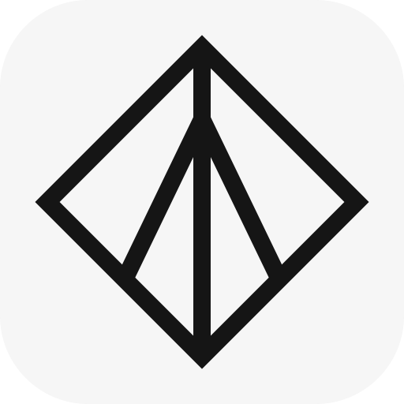
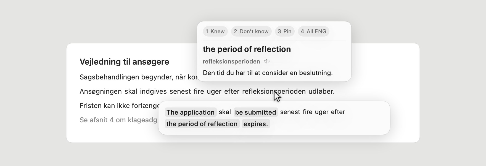

  <picture>
    <source media="(prefers-color-scheme: dark)" srcset="docs/images/logo-dark.png">
    
  </picture>

<h1 align="center">Babelstårnet</h1>

<strong>Hover any Danish word. Get the meaning. Keep reading.</strong>

  <picture>
    <source media="(prefers-color-scheme: dark)" srcset="docs/images/hover-dark.png">
    
  </picture>

Rendered from the app's own interface constants.

Babelstårnet is a local-first translator for Danish on macOS and Windows. Point at a word
anywhere on screen — a website, a PDF, a form, text inside an image — and its
meaning appears where you are already looking. Nothing to select, paste, or
submit.

## The idea

**Danish carries the sentence; English fills only the gaps.** Word order and
grammar stay Danish, and so does every word you can already read. Only the words
you cannot read are swapped for English, in place — so you get one line to read
rather than two texts to reconcile.

**Help adapts as words become familiar.** Reading supplies exposure cues;
optional feedback and review correct them. Those cues are estimates, not proof
of mastery. A direct lookup always gives the available meaning, and there is
no exercise to finish before you can keep reading.

**Nothing leaves your computer while reading.** No screenshot, recognized text, definition, or audio
is sent to a remote service.

The Word Book also offers **Read something new**, an optional, default-off
internet feature using DR's public RSS feeds. Matching recent learning happens
on your computer. News cards show an on-device English meaning by default,
including headlines without excerpts. Select a Danish word to look it up, listen
or save it; turn English support off whenever you want to try Danish first.
DR receives normal web requests; your vocabulary and screen
content are never sent with them. Background refresh and daily news digests
are separate opt-ins. Cached news remains available offline. An installed local
language model can simplify an RSS excerpt on request, with the original kept
visible. Full articles open in your browser. Press **4** in a lookup bubble for
a full sentence meaning; **Supported reading** keeps extra help available.

## Install

### Windows

Supports Windows 10 version 2004 or newer and Windows 11 (x64). Extract the
Windows ZIP from [Releases](https://github.com/Sininliny/Babelstaarnet/releases)
and run **Babelstaarnet.exe**. Install Danish OCR in Windows Language options,
then use **Settings → Local engines → Install / repair translation** to install the
local Argos engine (64-bit Python 3.12 required). After setup, reading works
offline. Press `Ctrl+Alt+Z` to start or pause; the app lives in the system tray.

Windows follows the Mac panel layout, settings, learning and review behavior.
Optional local Gemma 3 4B adds sentence-aware meanings and Danish explanations;
Piper provides offline Danish neural speech.

For setup, Windows shortcuts, building from source, and platform differences,
see the **[Windows guide](docs/WINDOWS.md)**. To build directly from this
repository, run `.\Scripts\build-windows.ps1` in PowerShell.

### macOS

Requires macOS 15 or newer. Download the latest ZIP from
[Releases](https://github.com/Sininliny/Babelstaarnet/releases) and open it.

Double-click **Install Babelstaarnet.command** in the folder it makes. Terminal
asks whether you are sure you want to open a script downloaded from the
Internet; click **Open**. It puts the app in **Applications**, starts it, and
tells you when it is done. The installer is plain text, and says at the top
exactly what it does — three lines of it do the work.

Then, in the app:

1. Click **Set up Babelstårnet**. It has no Dock icon; look in the menu bar.
2. Enable Babelstårnet in the System Settings page that opens — it needs Screen
   Recording permission to read what is on screen.
3. Relaunch the app if macOS asks.
4. Click **Start translating**, or press `Fn+Z`.

No account and no engine installation required.

#### Installing it by hand instead

Drag **Babelstaarnet.app** to **Applications** and double-click it. macOS says
it cannot verify the developer and offers only **Move to Trash** or **Done**;
click **Done**, open **System Settings → Privacy & Security**, scroll to the
line about Babelstaarnet being blocked, and click **Open Anyway**. Once only.

That button is the whole difference the installer makes. Up to macOS 14 you
could Control-click the app and choose **Open**;
[Apple removed that in macOS 15](https://www.macrumors.com/2024/08/06/macos-sequoia-gatekeeper-security-change/),
and this app requires macOS 15 — so if you have read that instruction anywhere
about this app, including in its own older releases, it no longer works.

The app **is** signed, ad-hoc: a signature macOS checks for damage on every
launch, and the one this project can produce. What it is not is *notarized*,
which needs a paid Apple Developer Program membership. macOS is reporting that
missing membership, not a finding about the app. Building from source has none
of this in the way — a bundle you built was never downloaded, so it is never
flagged, and `make install` puts it straight into **Applications**.

## Use

The shortcuts and optional contextual model below describe the macOS client.
Windows controls and supported features are listed in the [Windows guide](docs/WINDOWS.md).

Press `Fn+Z` to start reading, and again to stop. Hover a Danish word: its
meaning appears above the pointer, and the whole line below it.

| Key | Does |
| --- | --- |
| `1` | Mark the word **known** |
| `2` | Mark it **unknown** and show more English |
| `3` | Pin the bubbles |

You never have to press any of them. Hold Option to keep a bubble open while you
move the pointer to it; every shortcut is editable under **Settings →
Shortcuts**.

Every word you mark **unknown** or pin goes into your **Word Book**, with the
meaning the bubble gave and the sentence you met it in. Open it from the menu
bar to search it, hear a word again, or export it as CSV for flash cards.

When you want to, press **Review** there to go through the words whose time has
come round: the word in its sentence, then its meaning, then whether you knew
it. A word you knew comes back later each time, from a day up to two months; a
word you missed comes back within the hour. Reading never asks — the menu bar
only counts what is due.

What you learn about a word carries to its other forms. Once the language model
has said that `gik` is a form of `gå`, knowing `gå` means `gik` is left in
Danish the first time you meet it, with its meaning still a hover away.

For translations that follow the sentence — `får` as "gets" rather than
"sheep" — download the optional language model under **Settings → Contextual
meanings**. It runs on your Mac, like everything else here.

---

**[How it works →](docs/HOW_IT_WORKS.md)** — the recognition pipeline, the design
rules behind the bubbles, building from source, and the optional open-source
engines.

“Babelstårnet” is Danish for “the Tower of Babel.” The repository keeps the ASCII
spelling `Babelstaarnet`.

## Development

See [the cross-platform development guide](docs/DEVELOPMENT.md) for the repository
map, shared behavior examples, native test commands and performance tools.
Windows uses its own [Fluent design conventions](docs/WINDOWS_DESIGN.md).
Run `python Scripts/check-repository.py` to check language data, versions and
project references without downloading models. Open `Babelstaarnet.slnx` for
Windows development; the Swift package and existing build scripts keep their
current entry points.
